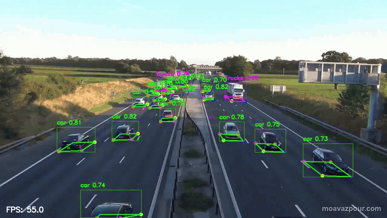

# Universal Roadside 3D Object Detector

One roadside 3D detection model trained on seven merged datasets — planned for integration at the High Definition Testfeld intersections in Ingolstadt.

> This page is the project's showcase.

**TH Ingolstadt** (university team project) · Project coordinator & data-pipeline lead · 03/2026 — 07/2026

Seven roadside and vehicle-side datasets merged into one unified dataset of 1.7M+ labeled objects. Validation tooling found a label-corruption issue affecting ~20% of labels, the main reason for low model confidence; tuning sampling and augmentation for class imbalance and small objects raised pose mAP50 from 0.44 to 0.86. The project manager accepted the final result as the basis for real-world deployment. Grade 1.0.

| Result | Value | Context |
|---|---|---|
| Grade | **1.0** | highest grade |
| Pose mAP50 | **0.44 → 0.86** | after sampling & augmentation tuning |
| Labeled objects | **1.7M+** | unified from 7 datasets |

## Data pipeline

- Evaluated public 3D datasets (KITTI, nuScenes, Waymo Open Dataset) against project needs and identified synchronisation and long-range annotation gaps.
- Defined a unified label schema, keypoint ordering, class taxonomy and train/val/test split across 7 roadside and vehicle-side datasets (LUMPI, RoScenes, TUMTraf, V2X-Radar, V2X-Seq, ZOD, DAIR-V2X).
- Built Python validation tooling that found a label-corruption issue affecting ~20% of labels — the main reason for low model confidence.
- Built a merging and conversion pipeline producing a unified dataset of 1.7M+ labeled objects.

## Model training

- Tuned sampling and augmentation for class imbalance and small objects, improving pose mAP50 from 0.44 to 0.86.

## Inference and deployment

- Added inference for images, video and live camera streams.
- The model is planned for integration at the High Definition Testfeld intersections in Ingolstadt; the project manager accepted the final result as the basis for real-world deployment.

## Tech stack

Python · PyTorch · MMDetection · YOLO Pose · CenterPoint · LiDAR / point clouds (PCL, Open3D) · Camera–LiDAR calibration · CUDA · Linux · Git

## License

[MIT](LICENSE) — applies to the documentation in this repository.
